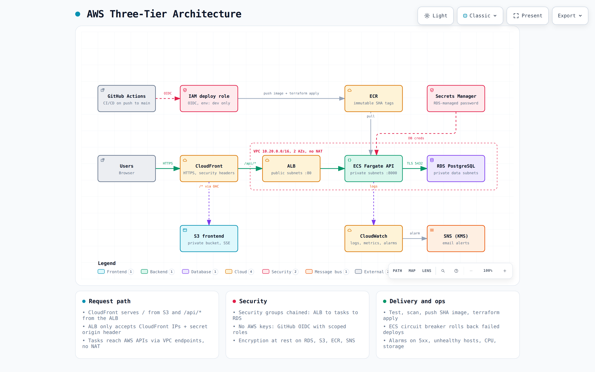

# AWS Three-Tier Application: IaC, Containers, CI/CD

A simple three-tier web app (static frontend → FastAPI backend → PostgreSQL) deployed on AWS
with **Terraform**, **Docker** and **GitHub Actions**. The application code is intentionally minimal;
the focus is the infrastructure, automation, security and observability around it.



> Interactive version: open [`docs/architecture.html`](docs/architecture.html) in a browser.
> Diagram source: [`docs/architecture.json`](docs/architecture.json).

| Tier | Service | Where |
|---|---|---|
| Presentation | S3 (private) + CloudFront (HTTPS) | edge |
| Application | FastAPI container on ECS Fargate, behind an ALB | private app subnets |
| Data | RDS PostgreSQL 16 | private data subnets |

---

## Contents
1. [Why AWS](#1-why-aws)
2. [Repository layout](#2-repository-layout)
3. [Run locally](#3-run-locally)
4. [Deploy to AWS](#4-deploy-to-aws)
5. [CI/CD pipeline](#5-cicd-pipeline)
6. [Secrets handling](#6-secrets-handling)
7. [Security](#7-security)
8. [Monitoring & logging](#8-monitoring--logging)
9. [Key decisions](#9-key-architectural-decisions)
10. [Trade-offs (time-boxed)](#10-trade-offs-made-for-the-time-limit)
11. [Going to production](#11-going-to-production)
12. [Cost, account & teardown](#12-cost-account-and-teardown)
13. [Evidence](#13-evidence)

---

## 1. Why AWS

- **ECS Fargate + RDS** give a fully managed container runtime and database with no servers or
  control plane to run. This is the smallest operational footprint that still looks like a real production layout.
- **GitHub OIDC → IAM** is first-class on AWS, so the pipeline *can* run with **zero long-lived credentials**
  (`ci_auth_mode = "oidc"`). The account used for this submission blocks it; see the note below.
- **CloudFront** gives free HTTPS on a `*.cloudfront.net` domain and can route `/api/*` to the ALB, so the
  frontend and API share one origin (no CORS, no custom domain needed).
- The free tier covers the database (`db.t4g.micro`) and most of the remaining small charges.

## 2. Repository layout

```
app/
  backend/             FastAPI API, pytest tests, multi-stage Dockerfile
  frontend/            Static index.html (+ nginx config used only for local runs)
infra/
  bootstrap/           One-time: TF state bucket, ECR repo, CI identity (OIDC or fallback users), CI roles
  modules/
    network/           VPC, 3 subnet tiers x 2 AZs, VPC endpoints, flow logs
    ecr/               Image repository (immutable tags, scan on push, lifecycle)
    ecs/               ALB, security groups, IAM task roles, cluster, task def, service, logs
    rds/               PostgreSQL, subnet group, SG, parameter group (force_ssl)
    frontend/          S3 bucket + CloudFront (OAC, /api/* routing, security headers)
    monitoring/        SNS (KMS) alerts, CloudWatch alarms, log metric filter, dashboard
  envs/dev/            Environment root: wires the modules together (one file per concern)
  .tflint.hcl          Lint rules (incl. AWS ruleset)
  .checkov.yml         IaC security scan config (documented skips)
.github/workflows/
  ci.yml               PR checks + reusable CI stage
  deploy.yml           main-branch pipeline: build -> test -> image -> deploy -> smoke test
docker-compose.yml     Local stack: Postgres + API + nginx
docs/                  Architecture diagram + screenshots
```

**Naming convention:** `<project>-<environment>-<component>`, e.g. `threetier-dev-api-tg`,
`threetier-dev-db`, `threetier-dev-alb-sg`.
**Tagging convention:** applied to every resource through the provider's `default_tags`:
`Project`, `Environment`, `Owner`, `ManagedBy=terraform`, `Repository`.

## 3. Run locally

Requirements: Docker with Compose v2.

```bash
docker compose up --build
# open http://localhost:8088   (WEB_PORT=xxxx to change the port)
curl localhost:8088/api/hello
curl -X POST localhost:8088/api/visits   # writes to Postgres
docker compose down -v
```

nginx mimics CloudFront locally: `/` serves the static page and `/api/*` is proxied to the API.

Run the tests without Docker:

```bash
cd app/backend
python3 -m venv .venv && . .venv/bin/activate
pip install -r requirements-dev.txt
ruff check . && pytest -v
```

## 4. Deploy to AWS

Tools: Terraform >= 1.10, AWS CLI v2, `gh` (optional).

**Step 1: bootstrap (once, with admin credentials on your machine).** This creates the state bucket,
the ECR repo, the CI identity and the two CI roles. It is the only step that uses human
credentials.

```bash
cd infra/bootstrap
# edit terraform.tfvars (github_owner / github_repo / owner)
terraform init && terraform apply
terraform output
```

**Step 2: configure GitHub (no secrets, only non-sensitive IDs).**

```bash
gh variable set AWS_REGION       --body eu-north-1
gh variable set TF_STATE_BUCKET  --body "$(terraform output -raw state_bucket)"
gh variable set ECR_REPOSITORY   --body threetier-dev-api
gh variable set AWS_PLAN_ROLE_ARN   --body "$(terraform output -raw plan_role_arn)"
gh variable set AWS_DEPLOY_ROLE_ARN --body "$(terraform output -raw deploy_role_arn)"
gh variable set ALERT_EMAIL      --body you@example.com
# Create the "dev" environment and restrict it to the main branch:
#   Settings -> Environments -> New "dev" -> Deployment branches: main
```

Only in `ci_auth_mode = "iam_user"`: send each CI user's key straight from AWS into GitHub
**encrypted secrets**. It is never printed or written to disk:

```bash
./scripts/rotate-ci-keys.sh   # deploy keys -> "dev" environment secrets, plan keys -> repo secrets
```

**Step 3: push to `main`.** The pipeline builds, tests, scans and pushes the image, runs
`terraform apply` for `infra/envs/dev`, publishes the frontend and smoke-tests the CloudFront URL.
Confirm the SNS subscription email to receive alerts.

Manual alternative (for example, the very first run from a laptop):

```bash
cd infra/envs/dev
cp backend.hcl.example backend.hcl   # fill in the bucket from bootstrap output
terraform init -backend-config=backend.hcl
terraform apply -var image_tag=<git-sha-already-in-ECR>
```

**Rollback:** redeploy a previous image by re-running the pipeline on an older commit
(`workflow_dispatch`), or `terraform apply -var image_tag=<previous-sha>`. Every image is kept
under its immutable SHA tag (the last 10 are retained). A deploy whose tasks never turn healthy is
rolled back automatically by the ECS deployment circuit breaker.

## 5. CI/CD pipeline

```
Pull request ─► ci.yml
  ├─ Build & test API ............ ruff + pytest
  ├─ Dockerfile lint/build/scan .. hadolint, docker build, Trivy (fail on fixable HIGH/CRITICAL)
  ├─ Terraform checks ............ fmt, validate, tflint, checkov
  └─ Terraform plan (dev) ........ read-only plan role, summary in the job output

Push to main ─► deploy.yml
  1. CI ............................ the whole ci.yml above (reused via workflow_call)
  2. Build, scan & push image ...... tag = commit SHA; Trivy gate *before* push to ECR
  3. Terraform apply ............... new task definition -> ECS rolling deploy (waits for steady state)
  4. Publish frontend .............. s3 sync + CloudFront invalidation
  5. Smoke test .................... GET /, GET /api/hello (asserts deployed SHA), POST /api/visits
```

- Third-party actions are **pinned to commit SHAs** (supply-chain hardening).
- Deploys are serialised (`concurrency: deploy-dev`, never cancelled mid-apply).
- Workflow token permissions default to `contents: read`; `id-token: write` is granted only to jobs that need AWS.

## 6. Secrets handling

**There are no secrets in the repository or in GitHub.**

| Secret | How it is handled |
|---|---|
| AWS credentials for CI | **Preferred (`oidc`):** none exist. GitHub's OIDC token is exchanged for a 1-hour STS session. The deploy role trusts only `repo:<owner>/<repo>:environment:dev`. **Used here (`iam_user`):** two credential-only IAM users whose *only* permission is `sts:AssumeRole` into the same roles, so every job still runs on 1-hour STS credentials. Deploy keys are **encrypted secrets of the `dev` environment**, which accepts only the `main` branch. Plan keys are repository secrets for the **read-only** plan role. Keys go from AWS to GitHub by script, never displayed, and are rotated by re-running it. |
| Database password | Generated by RDS (`manage_master_user_password`) and stored in **Secrets Manager**. ECS injects it into the container at start (`secrets:` in the task definition). It never appears in code, images, the task definition, Terraform variables or state. |
| CloudFront → ALB origin header | Random value generated by Terraform. It lives only in the encrypted remote state and the AWS configs. |
| GitHub configuration | Only non-sensitive identifiers (role ARNs, bucket name) are stored, as **variables**, not secrets. |
| Local development | `docker-compose.yml` uses a throwaway local password that is never used in AWS. |

## 7. Security

**Network: only required ports, chained security groups**

| From → To | Port | Rule |
|---|---|---|
| Internet → CloudFront | 443 (80 redirects) | viewer protocol `redirect-to-https`, TLS 1.2+ |
| CloudFront → ALB | 80 | ALB SG allows only the AWS-managed **CloudFront origin-facing prefix list**. The listener returns 403 unless the secret `X-Origin-Verify` header is present. |
| ALB → ECS tasks | 8000 | task SG references the ALB SG only |
| ECS tasks → RDS | 5432 | DB SG references the task SG only |
| ECS tasks → AWS APIs | 443 | VPC endpoints only (ECR, Logs, Secrets Manager, S3 gateway). **There is no NAT gateway, and the private subnets have no internet route.** |

The default security group is emptied. RDS is not publicly accessible. VPC flow logs record rejected traffic.

**IAM: least privilege**
- The task **execution role** can pull from one ECR repo, write to one log group and read one secret. It does not use the broad managed policy.
- The task **role** (application) has **no permissions**, because the app calls no AWS APIs.
- The CI **plan role** is `ReadOnlyAccess` and can only be assumed from pull requests.
- The CI **deploy role** is limited to the services this stack uses, to one region, to IAM roles
  named `threetier-dev-*`, and to `iam:PassRole` to `ecs-tasks`/`vpc-flow-logs` only.
- **No privilege escalation through CI:** the deploy role can create or change a role *only if* that role
  carries the `threetier-dev-workload-boundary` permissions boundary. The boundary is created by bootstrap and caps
  every CI-created role at ECR pull, project log groups and RDS-managed secrets. Both CI roles also have an explicit
  `Deny` on reading secret values and on removing or replacing boundaries.

**Encryption**
- At rest: RDS (KMS), S3 (SSE), ECR (AES256), SNS (customer KMS key with rotation), state bucket (SSE + versioning).
- In transit: HTTPS to CloudFront, `rds.force_ssl=1` with `sslmode=require` from the app, and S3 bucket policies deny non-TLS requests.

**Container hardening**
- Multi-stage build: compilers and pip are not in the final image (about 49 MB compressed).
- The container runs as UID 10001 (non-root), with a read-only root filesystem on ECS and a `HEALTHCHECK`.
- Trivy blocks images with fixable HIGH/CRITICAL CVEs. ECR also scans on push. Tags are immutable.

**IaC scanning:** tflint and checkov run on every PR. The skipped checkov rules are listed with
reasons in [`infra/.checkov.yml`](infra/.checkov.yml).

## 8. Monitoring & logging

- **Logs:** API stdout goes to CloudWatch Logs (`/ecs/threetier-dev/api`), alongside RDS PostgreSQL logs
  and VPC flow logs. Retention is 14 days.
- **Metrics:** ECS Container Insights, plus ALB, RDS and a custom log-derived metric.
- **Dashboard:** `threetier-dev-overview` shows requests/5xx/4xx, p95 latency, ECS CPU/memory, RDS CPU/connections,
  alarm status and a Logs Insights table of recent errors.
- **Alarms** (all go to SNS, which emails the address in `ALERT_EMAIL`):

| Alarm | Condition |
|---|---|
| `threetier-dev-api-5xx` | ≥ 5 target 5xx in 1 min |
| `threetier-dev-api-unhealthy-targets` | any unhealthy target for 2 min |
| `threetier-dev-api-cpu-high` | ECS CPU > 80% for 3 min |
| `threetier-dev-db-cpu-high` | RDS CPU > 80% for 15 min |
| `threetier-dev-db-storage-low` | free storage < 2 GiB |
| `threetier-dev-api-error-logs` | ≥ 10 `ERROR` log lines in 5 min |

**Alarm demo:** `GET /api/boom` deliberately returns 500 and logs an error:

```bash
for i in $(seq 1 20); do curl -s -o /dev/null "$APP_URL/api/boom"; done
```

Within about 1–2 minutes, `threetier-dev-api-5xx` goes to ALARM and the email arrives.

## 9. Key architectural decisions

| Decision | Why |
|---|---|
| **ECS Fargate** over EC2/EKS | No nodes to patch, and per-task IAM and security groups. EKS would be overkill for one service. |
| **CloudFront in front of everything** | One HTTPS origin for UI + API, free TLS and caching for static files. The ALB is not directly reachable. |
| **No NAT gateway; VPC endpoints instead** | Cheaper for this footprint, and private subnets get *no* internet egress at all (smaller attack surface). |
| **RDS-managed master password** | AWS generates and rotates it in Secrets Manager. Terraform never sees it. |
| **ECR + state bucket in a separate `bootstrap` stack** | Avoids the chicken-and-egg problem (an image must exist before the service starts) and keeps long-lived artifacts out of environment teardown. |
| **Image tag = git SHA, immutable** | Every running task traces back to an exact commit, rollback is a re-deploy of an old SHA, and `latest` is never used. |
| **Terraform deploys the app too** (`-var image_tag`) | One source of truth with no drift between Terraform's task definition and what CI deployed. |
| **S3 native state locking** (`use_lockfile`) | Terraform ≥ 1.10 locks in S3, so a DynamoDB table is no longer needed. |
| **Modules per concern + thin env root** | Adding `staging`/`prod` is a new `envs/<name>` folder with different variables. |

## 10. Trade-offs made for the time limit

- **Single environment (`dev`)**: there is no staging, and the deploy happens directly after CI. The structure supports more environments.
- **HTTP between CloudFront and the ALB**: this requires a custom domain and an ACM certificate to fix. It is mitigated by the
  CloudFront-only prefix list and the secret origin header.
- **Single ECS task and single-AZ RDS** (`multi_az = false`, 1-day backups) to stay within free/low cost.
  The subnets already span 2 AZs, so HA is a variable flip.
- **The deploy role is service-scoped, not resource-scoped** for every action (e.g. `ec2:*` in one region). This is
  pragmatic for a role that runs `terraform apply`, and IAM escalation is closed by the permissions boundary. In production,
  split infrastructure and app pipelines, scope by `aws:ResourceTag/Project`, and use a dedicated AWS account per environment.
- **The deploy role controls the whole stack**, so it could also reset the DB password or create roles that trust
  another principal. Those roles are still capped by the permissions boundary. In production, pre-create the workload roles in
  the bootstrap stack and remove `iam:CreateRole` from CI.
- **The PR plan role can read Terraform state**, which contains the origin-verify header value. Only repository collaborators can
  trigger it, because fork PRs never receive an OIDC token.
- **No WAF, access logs or CMKs** for every service (see the checkov skips). The cost/complexity is not justified for a demo.
- **Schema creation in app code** (`CREATE TABLE IF NOT EXISTS`) instead of a migration tool.
- **Bootstrap uses local state** (it creates the state bucket). It could be migrated into the bucket afterwards.

## 11. Going to production

**High availability:** set `api_desired_count ≥ 2` (tasks spread across both AZs), `db_multi_az = true`, and
consider Aurora PostgreSQL for faster failover and read replicas. Add ECS service auto scaling (target tracking on
CPU / ALB requests per target), set `deletion_protection`, and turn on final snapshots and 7–35 day backups with PITR.

**Scale:** CloudFront already absorbs static traffic. Add an `/api` cache policy where responses are cacheable,
RDS Proxy for connection pooling, Fargate Spot for non-critical capacity, and a read replica for read-heavy paths.
Move to separate `staging`/`prod` **AWS accounts** (AWS Organizations) using the same modules, with promotion of
the same image SHA and a manual approval gate on `prod`.

**Security:** use a custom domain, ACM certificates and HTTPS end to end (CloudFront → ALB → optionally the tasks). Add AWS WAF
(managed rule sets, rate limiting), GuardDuty, Security Hub, CloudTrail organization trail, KMS CMKs for logs/S3/ECR,
access logs (ALB/CloudFront/S3), and a permissions boundary on CI roles.

**Cost:** NAT-free endpoints suit low egress. At larger scale, compare endpoint-hours against a NAT gateway per AZ.
Add Savings Plans / Reserved Instances for steady load, Fargate Spot, S3/CloudWatch log lifecycle tiers, budgets and
cost-allocation tags (already in place via `default_tags`).

## 12. Cost, account and teardown

- Account: a new AWS account on the **AWS Free plan** (credits only, so the card is never charged). The Free plan wraps the
  account in AWS-managed guardrails (SCPs): only **`eu-north-1`** is usable and **`iam:CreateOpenIDConnectProvider` is
  denied**. That is why this submission runs with `ci_auth_mode = "iam_user"` and region `eu-north-1`. On a normal account,
  set `ci_auth_mode = "oidc"` and the same code is fully keyless.
- Hourly running cost (approx.): ALB about $0.03, 4 interface endpoints × 2 AZs about $0.10, Fargate 0.25 vCPU/0.5 GB about $0.012,
  RDS `db.t4g.micro` free tier. That comes to **about $3–4 per day**, so the stack was destroyed after the evidence was captured.
- Teardown:

```bash
cd infra/envs/dev && terraform destroy -var image_tag=destroy
cd ../../bootstrap && terraform destroy      # optional: removes state bucket, ECR, CI identity and roles
```

## 13. Evidence

Screenshots are in [`docs/screenshots/`](docs/screenshots/):

| What | File |
|---|---|
| Successful `deploy` pipeline run | `pipeline-run.png` |
| App in the browser (CloudFront URL) | `app.png` |
| ECS service / running task | `ecs-service.png` |
| CloudWatch dashboard | `dashboard.png` |
| `api-5xx` alarm in ALARM state + email | `alarm.png`, `alarm-email.png` |
